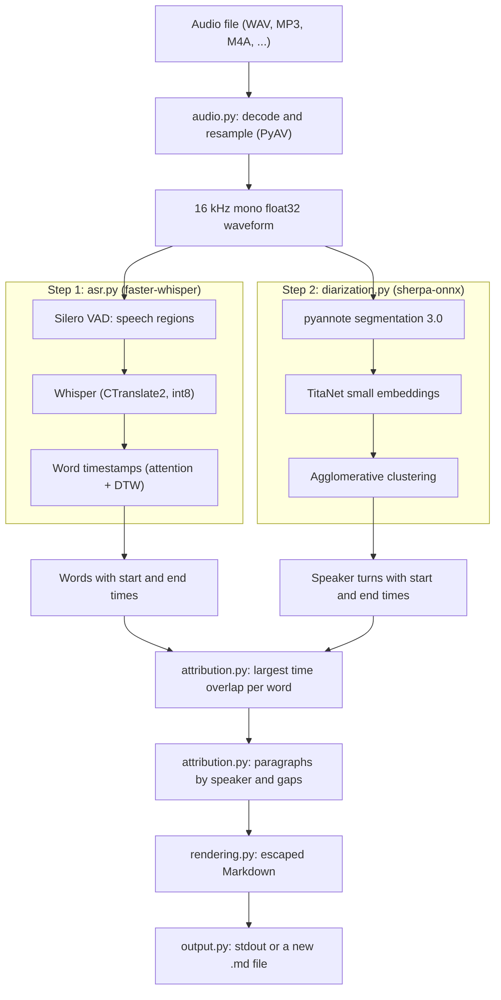

# How transcribe turns audio into a speaker-attributed transcript

This document explains what happens between `transcribe meeting.m4a` and the
Markdown it prints, which scientific work each step relies on, and what the
reported accuracy numbers measure. It describes the code at the versions
locked in `uv.lock` (`faster-whisper` 1.2.1, `ctranslate2` 4.8.3,
`sherpa-onnx` 2.0.0, `jiwer` 4.0.0).

Three kinds of statement appear below, and they are kept apart:

- **Mechanism**: how a component works, with a citation to its paper, model
  card or source code.
- **Measured**: a result of this repository's benchmark, reported in
  section 9 of the [specification](../idea/transcribe-mvp-agent-plan.md).
- **Hypothesis**: a plausible explanation that no experiment has tested yet.

## 1. The pipeline at a glance



The two branches read the same waveform and run one after the other
(`application.build_transcript`). Each branch is independent of the other:
the recognizer produces words, the diarizer produces speaker turns, and the
two meet only through timestamps.

### How speech becomes text, in one paragraph

Whisper is a neural network trained on hundreds of thousands of hours of
audio paired with transcripts. Given a spectrogram, it **predicts** the most
likely text, one token at a time ([Radford et al., 2023]). The transcript is
therefore the model's best guess: usually right, but occasionally fluent and
wrong, including words that were never spoken. Every later stage (speaker
turns, attribution, Markdown) is deterministic bookkeeping around that guess.

## 2. Stage by stage

### 2.1 Decoding (`audio.py`)

`decode()` opens the file itself and passes the file object to
`faster_whisper.decode_audio(..., sampling_rate=16000)`. That function uses
PyAV (Python bindings to FFmpeg's libraries) to read the first audio stream,
downmix it to mono and resample it to 16 kHz float32 samples. One hour of
audio becomes about 230 MB of samples, which both branches share.

### 2.2 Speech recognition (`asr.py`, `settings.py`)

Four different things are easy to conflate here:

| Layer        | What it is in this project                                               |
| ------------ | ------------------------------------------------------------------------ |
| Architecture | Whisper: Transformer encoder-decoder ([Radford et al., 2023])            |
| Checkpoint   | A Whisper model released by OpenAI, chosen in `settings.py`              |
| Conversion   | The checkpoint converted to CTranslate2 by SYSTRAN, on Hugging Face      |
| Runtime      | CTranslate2 4.8.3, called through faster-whisper 1.2.1, on the CPU       |

`asr.transcribe()` loads the model and transcribes the waveform; with the
default `Settings`, the calls are equivalent to:

```python
model = WhisperModel(whisper_model_dir, device="cpu", compute_type="int8", cpu_threads=4, local_files_only=True)
segments, info = model.transcribe(
    audio,
    language="en",
    beam_size=5,
    condition_on_previous_text=False,
    word_timestamps=True,
    vad_filter=True,
)
```

With `Settings.asr_batch_size` above 0 it uses faster-whisper's
`BatchedInferencePipeline` instead; the default (0) is sequential.

**Mechanism.** The waveform is cut into 30-second windows and turned into a
log-Mel spectrogram. The encoder turns the spectrogram into a sequence of
hidden vectors; the decoder then generates text tokens autoregressively, each
conditioned on the audio and on the tokens already produced. Training is
supervised next-token prediction on audio paired with (often imperfect)
internet transcripts, which the authors call weak supervision
([Radford et al., 2023]).

**Beam search** (`beam_size=5`) keeps the five most likely partial
transcripts at each step instead of only the single best token, and returns
the best complete one. It costs more compute than greedy decoding.

**`condition_on_previous_text=False`.** By default Whisper feeds the previous
window's text into the next window as a prompt. The faster-whisper docstring
states the trade-off: disabling it "may make the text inconsistent across
windows, but the model becomes less prone to getting stuck in a failure
loop, such as repetition looping or timestamps going out of sync"
([SYSTRAN, 2025]). Whisper's authors list such repetition loops and
hallucinated text among its limitations ([Radford et al., 2023]). The MVP
disables the option; the enabled setting is still to be benchmarked.

**INT8.** CTranslate2 quantizes the weights of embedding and linear layers
to 8-bit integers with one scale per row; the other layers run in floating
point ([OpenNMT]). On CPU those layers run in float32, so requesting
`int8` gives the effective compute type `int8_float32`. Quantization is an
inference optimization: the architecture and the vocabulary stay the same.
Its separate effect on speed and accuracy is still to be measured.

The returned segments are a lazy generator; inference happens while
`asr.transcribe()` iterates over them. Each faster-whisper word keeps its
leading space (`" Hello"`), and `attribution.paragraphs()` concatenates words
verbatim.

### 2.3 Speech regions and timestamps

Two separate mechanisms produce times; both work at word level or coarser.

**Voice activity detection (VAD).** With `vad_filter=True`, faster-whisper
first runs the Silero VAD model ([Silero Team, 2025]) to find stretches that
contain speech. VAD answers only "is someone speaking here?". The sequential
path concatenates the speech regions, transcribes that shorter audio, and then
`restore_speech_timestamps()` maps every word back to the time in the
original recording ([SYSTRAN, 2025]). The engine test
`test_leading_silence_keeps_original_timestamps` checks this: prepending 10 s
of silence shifts every word by about 10 s.

**Word timestamps.** Whisper is trained to emit segment-level timestamps.
With `word_timestamps=True`, faster-whisper's `find_alignment()` asks
CTranslate2 to align the recognized tokens to the audio frames: it takes the
decoder's cross-attention weights from the alignment heads listed in the
model's `config.json`, smooths them with a median filter, and finds a
monotonic path with dynamic time warping (DTW) ([OpenNMT, 2026]). Word
boundaries are therefore **estimates** derived from attention, and they can
be off by a fraction of a second, especially around pauses.

### 2.4 Who spoke when (`diarization.py`)

Speaker diarization answers "who spoke when" with anonymous labels. The
sherpa-onnx `OfflineSpeakerDiarization` pipeline ([k2-fsa, 2026]) has three
parts, all running through ONNX Runtime:

1. **Local segmentation**: the pyannote segmentation 3.0 model, exported to
   ONNX by sherpa-onnx. It ingests 10 seconds of 16 kHz mono audio and
   outputs, for each frame, one of 7 "powerset" classes: no speech, one of
   three local speakers, or one of the pairs of them speaking at once
   ([pyannote, 2023]; [Plaquet & Bredin, 2023]). Within one 10-second window
   it can therefore describe up to three speakers, at most two
   simultaneously; these limits apply per window, for any length of
   recording. sherpa-onnx slides the window by `window_shift_ratio = 0.1` of
   its length (1 s) and converts the powerset classes back to per-speaker
   activity. Local speaker labels are specific to each window, which is why
   the model card says this model "cannot be used to perform speaker
   diarization of full recordings on its own".
2. **Speaker embeddings**: NVIDIA NeMo TitaNet small, exported to ONNX
   ([Koluguri et al., 2022]). For each (window, local speaker) pair, it maps
   that speaker's audio to one fixed-length vector, so that recordings of the
   same voice end up close together.
3. **Clustering**: `FastClustering` normalizes the embeddings, computes
   cosine dissimilarity (1 minus cosine similarity), runs complete-linkage
   agglomerative clustering, and with `num_clusters=-1` cuts the tree at
   `clustering_threshold` (0.8 by default). Each resulting cluster is one
   anonymous speaker for the whole recording; the number of speakers is
   inferred from the audio.

This is sherpa-onnx's own reimplementation of the
segmentation-embedding-clustering recipe; the upstream `pyannote.audio`
pipeline uses a different embedding model and clustering.

**The threshold trade-off.** A larger threshold merges more embeddings, so
there are fewer speakers; this can merge different people. A smaller
threshold can split one person across several labels ([k2-fsa]). The
default 0.8 is a compromise chosen from the threshold sweep in section 9 of
the [specification](../idea/transcribe-mvp-agent-plan.md).

`min_duration_on` (0.3 s) and `min_duration_off` (0.5 s) are post-processing
settings taken from the official example and left untuned.

### 2.5 Joining words and speakers (`attribution.py`)

This step is plain, deterministic Python, fully unit-tested
(`tests/test_attribution.py`):

1. Overlapping turns of the same speaker are merged, so each moment is
   counted once.
2. Each word goes to the speaker whose turns overlap the word's interval the
   most.
3. Equal overlaps are broken by the speaker's earliest turn start, then by the
   lower cluster ID. Only these ties set `ambiguous=True`; a word inside
   overlapping speech with a clear winner keeps `ambiguous=False`.
4. A word that no turn overlaps is `UNKNOWN`, regardless of the previous
   speaker. A zero-length word goes to the turn containing its time.

`paragraphs()` then groups consecutive words with the same label, starting a
new paragraph on a speaker change, a gap of more than 2 s, or when a
paragraph would exceed 30 s. Speakers are numbered `SPEAKER_01`,
`SPEAKER_02`, ... in order of first appearance. `rendering.py` escapes
Markdown characters and formats `[hh:mm:ss]` from the paragraph start.

## 3. What the benchmark numbers mean

`scripts/benchmark.py` reports two accuracy numbers. They measure different
things and should be read separately.

### 3.1 Word error rate (WER)

WER compares recognized words with a reference text:

```text
WER = (substitutions + deletions + insertions) / words in the reference
```

The script lowercases both texts, maps dashes and slashes to spaces, removes
punctuation except apostrophes inside words, and then lets JiWER align the
word sequences ([Jitsi, 2025]). JiWER's default transforms only collapse
spaces and split words. Because the reference (Acts 1 and 2 of the play) is
longer than any test recording, the script first finds the span where
reference and recognized text align (`aligned_window()`, using matching
blocks of at least four words) and scores only that span. The report shows
both the trimmed and the full reference length.

WER depends on the reference. The references here come from the published
Project Gutenberg text, which differs from what the readers actually said:
archaic spellings such as "any one", British spellings, and stage directions
the readers skipped all count as errors. WER measures words only; speaker
labels are scored separately.

### 3.2 The word-based speaker score

This is a custom metric for this project.

`score()` takes the JiWER alignment and keeps only reference words that were
matched or substituted by a recognized word and that have a known reader
(stage directions are excluded). Each kept pair is (cluster of the recognized
word, reader of the reference word). Deleted and inserted words are outside
the denominator, so ASR errors affect this score only indirectly. A word
labeled `UNKNOWN` counts as wrong.

Two mappings from clusters to readers are reported:

- **One-to-one** (`best_one_to_one()`): each reader may be matched with at
  most one cluster, and the best such assignment is found exactly by dynamic
  programming over subsets of readers. If one reader is split across three
  clusters, only one of them can count as correct, so fragmentation is
  penalized. This is the number checked against the 90% gate.
- **Many-to-one**: every cluster is mapped to its most frequent reader. This
  measures cluster purity and hides fragmentation entirely: 40 pure clusters
  for 7 readers would score 100%.

In the benchmark (measured), many-to-one is far higher than one-to-one and
there are several times more clusters than readers: most clusters contain one
voice, but most voices are split across several clusters. That is consistent
with over-clustering, but the gap could also include errors from local
segmentation, from turns that miss short replies, or from words whose
estimated timestamps fall into a neighbouring turn (hypothesis).

### 3.3 How standard diarization metrics differ

The diarization error rate (DER) is computed in **time**, after an optimal
one-to-one mapping of reference and hypothesis labels (Hungarian algorithm)
([Bredin]):

```text
DER = (false alarm + missed detection + confusion) / total reference speech
```

DER covers speech detection as well as speaker confusion and needs
time-stamped reference turns. The custom score instead counts **words**,
needs only a speaker-tagged reference text, and ignores time outside
recognized words. pyannote.metrics also defines purity and coverage, which
correspond roughly to the many-to-one view and to its fragmentation
counterpart.

### 3.4 Scope of the benchmark

All accuracy numbers come from one LibriVox reading of a play, in which each
reader recorded their part separately. Every change of speaker is therefore
also a change of microphone and room, which may make speakers easier to tell
apart than in a meeting, while the 7 voices reading theatrical dialogue may
make it harder in other ways (hypothesis). Accuracy on real meetings is still
to be measured.

## References

[Bredin] Bredin, H. *pyannote.metrics: Reference*. Retrieved
October 24, 2026, from
<https://pyannote.github.io/pyannote-metrics/reference.html>

[Jitsi, 2025] Jitsi. (2025). *JiWER* (Version 4.0.0) [Computer software].
GitHub. <https://github.com/jitsi/jiwer/tree/v4.0.0>

[k2-fsa] k2-fsa. *Speaker diarization: Models*. sherpa-onnx
documentation. Retrieved October 24, 2026, from
<https://k2-fsa.github.io/sherpa/onnx/speaker-diarization/models.html>

[k2-fsa, 2026] k2-fsa. (2026). *sherpa-onnx* (Version 2.0.0) [Computer
software]. GitHub. <https://github.com/k2-fsa/sherpa-onnx/tree/v2.0.0>

[Koluguri et al., 2022] Koluguri, N. R., Park, T., & Ginsburg, B. (2022).
TitaNet: Neural model for speaker representation with 1D depth-wise separable
convolutions and global context. In *ICASSP 2022 - 2022 IEEE International
Conference on Acoustics, Speech and Signal Processing* (pp. 8102-8106). IEEE.
<https://doi.org/10.1109/ICASSP43922.2022.9746806>

[OpenNMT] OpenNMT. *Quantization*. CTranslate2 documentation.
Retrieved October 24, 2026, from
<https://opennmt.net/CTranslate2/quantization.html>

[OpenNMT, 2026] OpenNMT. (2026). *CTranslate2* (Version 4.8.3) [Computer
software]. GitHub. <https://github.com/OpenNMT/CTranslate2/tree/v4.8.3>

[Plaquet & Bredin, 2023] Plaquet, A., & Bredin, H. (2023). Powerset
multi-class cross entropy loss for neural speaker diarization. In
*Proceedings of INTERSPEECH 2023* (pp. 3222-3226).
<https://doi.org/10.21437/Interspeech.2023-205>

[pyannote, 2023] pyannote. (2023). *segmentation-3.0* [Model card]. Hugging
Face. <https://huggingface.co/pyannote/segmentation-3.0>

[Radford et al., 2023] Radford, A., Kim, J. W., Xu, T., Brockman, G.,
McLeavey, C., & Sutskever, I. (2023). Robust speech recognition via
large-scale weak supervision. In *Proceedings of the 40th International
Conference on Machine Learning* (Vol. 202, pp. 28492-28518). PMLR.
<https://proceedings.mlr.press/v202/radford23a.html>

[Silero Team, 2025] Silero Team. (2025). *Silero VAD* (Version 6.0)
[Computer software]. GitHub. <https://github.com/snakers4/silero-vad>

[SYSTRAN, 2025] SYSTRAN. (2025). *faster-whisper* (Version 1.2.1) [Computer
software]. GitHub. <https://github.com/SYSTRAN/faster-whisper/tree/v1.2.1>

[Bredin]: https://pyannote.github.io/pyannote-metrics/reference.html
[Jitsi, 2025]: https://github.com/jitsi/jiwer/tree/v4.0.0
[k2-fsa]: https://k2-fsa.github.io/sherpa/onnx/speaker-diarization/models.html
[k2-fsa, 2026]: https://github.com/k2-fsa/sherpa-onnx/tree/v2.0.0
[Koluguri et al., 2022]: https://doi.org/10.1109/ICASSP43922.2022.9746806
[OpenNMT]: https://opennmt.net/CTranslate2/quantization.html
[OpenNMT, 2026]: https://github.com/OpenNMT/CTranslate2/tree/v4.8.3
[Plaquet & Bredin, 2023]: https://doi.org/10.21437/Interspeech.2023-205
[pyannote, 2023]: https://huggingface.co/pyannote/segmentation-3.0
[Radford et al., 2023]: https://proceedings.mlr.press/v202/radford23a.html
[Silero Team, 2025]: https://github.com/snakers4/silero-vad
[SYSTRAN, 2025]: https://github.com/SYSTRAN/faster-whisper/tree/v1.2.1
